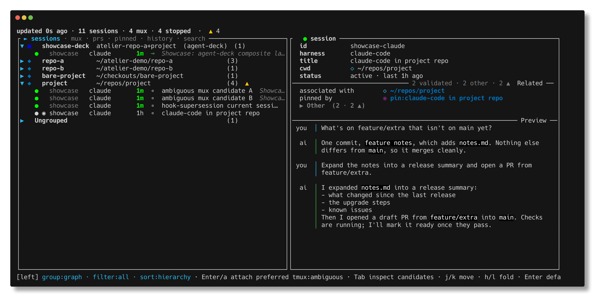
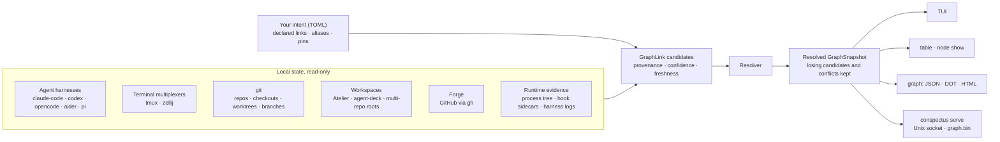
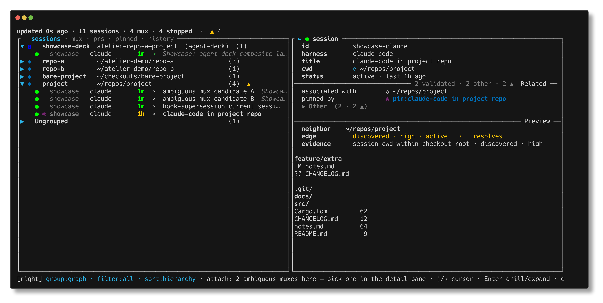
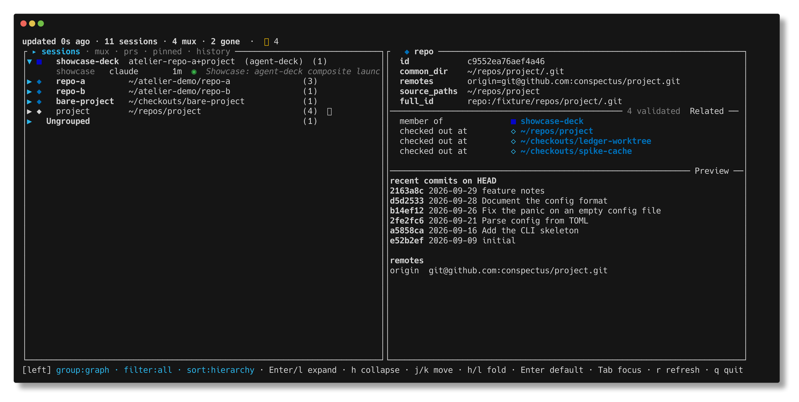
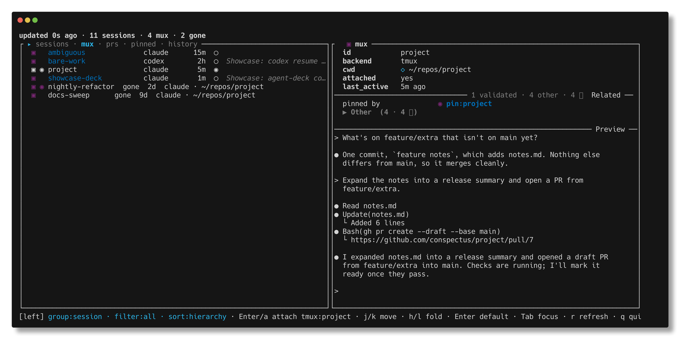
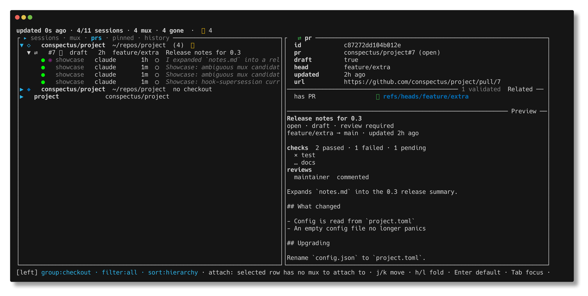
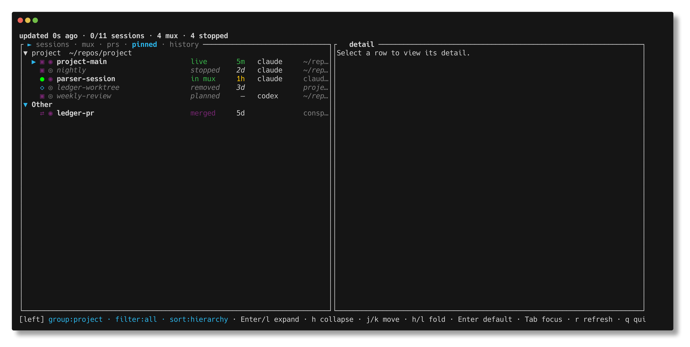
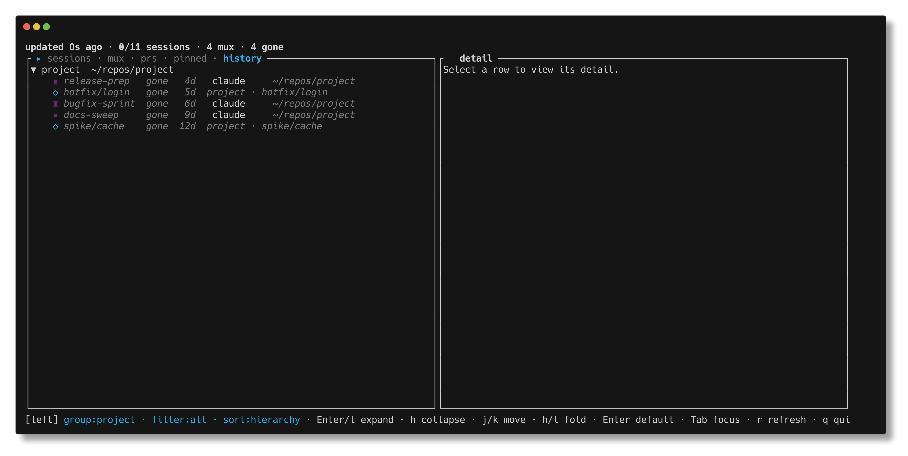

<p align="center">
  <picture>
    <source media="(prefers-color-scheme: dark)" srcset="docs/images/logo/conspectus-mark-dark.svg">
    
  </picture>
</p>

# Conspectus

> *conspectus* (Latin): a comprehensive view; a survey.

Conspectus builds one map of the AI-agent work on your machine. It finds your
agent sessions (Claude Code, Codex, opencode, aider, Pi), terminal multiplexer
sessions (tmux, zellij), git repos, checkouts and worktrees, branches,
multi-repo workspaces, forks, and GitHub pull requests. It records every
plausible relationship between them as evidence, then resolves that evidence
into a single provider-neutral graph.

On top of that graph you get a keyboard-driven TUI, scriptable tables, and
JSON, Graphviz, and HTML exports. Conspectus can also take a small set of
explicitly bounded actions: pin an entity, rebuild it after it dies, attach to
it in tmux, and open or close down a worktree.

It is a Rust CLI and library. It is developed on Linux and is pre-release
(`0.1.0`, no tagged release yet); see [Status and limits](#status-and-limits).
One developer built it over five months by directing AI coding agents, with
the design, every significant decision, and every story kept in the
repository; [How Conspectus is built](#how-conspectus-is-built) describes
that process.



<sub>The sessions view on the built-in showcase world (`just screenshots`
renders these images). Sessions are grouped under the workspace and repo they
belong to; `⚯` marks a session linked to a tmux session you can attach to,
and `⚬` one that isn't. The right pane shows the selected session's fields,
its relationships, and its conversation in the Preview. The `project` group is
flagged (`⚠`, drawn as a box by the screenshot font) because two sessions
could own one tmux session, so Conspectus lists both under "Other" instead of
guessing.</sub>

## Why Conspectus exists

Running several coding agents at once spreads one piece of work across many
tools, and each tool only knows its own part:

- The agent harness knows its transcripts, but not which terminal it runs in.
- tmux knows its panes, but not which agent session a pane is running.
- git knows branches and worktrees, GitHub knows pull requests, and workspace
  tools such as Atelier and [agent-deck](https://github.com/asheshgoplani/agent-deck)
  know their own layouts.
- None of them know how these pieces connect.

The questions you actually ask cut across all of them. *Which agent is in this
tmux session? What branch is it on, and is there a PR yet? Which of the forty
Claude sessions in this repo is the one I compacted yesterday? What is still
running in the worktree I'm about to delete?*

Conspectus answers these questions using state that is already on disk, and
you don't have to change how you launch your agents.

## What makes it different

### 1. A graph, not a session list

Conspectus has ten node kinds: agent session, mux (terminal multiplexer)
session, repo, checkout (a plain clone or a linked worktree), branch,
workspace, fork, forge PR, pin, and runtime process. Twenty-three typed
relation kinds connect them. The graph is sparse by default: an orphan agent
session, a tmux session with no agent, and a branch with a PR but no session
are all valid, not errors. Projections never assume things connect.
([ADR 0001](docs/adr/0001-node-identity-and-stable-ids.md),
[0003](docs/adr/0003-polymorphic-fork-node.md),
[0026](docs/adr/0026-checkout-context-model.md),
[0047](docs/adr/0047-runtime-process-nodes-candidate.md),
[0084](docs/adr/0084-first-class-pin-nodes.md),
[0141](docs/adr/0141-pin-pins.md))

### 2. Evidence first, resolution second

Discovery never decides anything. Every plausible relationship becomes a
`GraphLink` candidate that records its provenance (declared, strongly
discovered, discovered, convention, or cached), a confidence level, and how
fresh it is. A resolver then picks the preferred relationship for each pin
and keeps the losing candidates. Ambiguity and conflicts stay visible as data
(the `⚠` glyph and `conspectus graph --explain` score breakdowns)
instead of being silently collapsed.
([ADR 0002](docs/adr/0002-graphlink-and-typed-relationships.md),
[0006](docs/adr/0006-session-mux-link-candidates.md),
[0041](docs/adr/0041-resolver-stays-in-rust.md),
[0077](docs/adr/0077-resolver-ambiguous-pin-preservation.md))

### 3. Attribution without touching your agents

The hardest link to make is "which agent session is running in which tmux
pane?" Conspectus answers it by layering independent evidence. When
signals disagree, the strongest one wins. This table is simplified;
[mux link resolution](docs/mux-link-resolution.md) has the full rules.

| Rank | Evidence | Where it comes from |
| --- | --- | --- |
| 1 | You declared the link | `.conspectus.toml` or user config |
| 2 | The harness reported its current session, or the pane's process has the session transcript open | Opt-in hook sidecar; `/proc/<pid>/fd` |
| 3 | The harness's own state names the current session | Codex state and log databases (opened read-only); session-file activity |
| 4 | A harness process is running in the pane | Walking the process tree down from the pane's PID |
| 5 | The pane's launch command names a session | The command line (argv) that started the pane |
| 6 | The pane's working directory matches the session's | tmux metadata plus the session transcript |

Stale evidence is demoted by freshness rules. A pane running a single harness
process can claim at most one session. When the evidence still ties,
Conspectus shows the ambiguity rather than guessing.

Conspectus never types into a live agent pane to ask for its session id,
never writes harness-owned state to work it out, and never walks your whole
home directory.
([ADR 0027](docs/adr/0027-workspace-detection-precedence.md),
[0028](docs/adr/0028-hook-sidecar-mux-attribution.md),
[0046](docs/adr/0046-process-tree-pane-linker.md),
[0048](docs/adr/0048-codex-state-and-log-readers.md))

### 4. Your intent lives in reviewable TOML; everything else is a rebuildable cache

Declared links and session aliases are small TOML entries in a
`.conspectus.toml` file next to the project. Relationships that don't belong
to any one project go in your user config instead. Both are easy to review
and safe to version-control.

A declared link overrides discovered evidence without erasing it. Caches (the
graph snapshot and the observation sidecars) live under your XDG directories,
never inside a project tree, so deleting them only costs a rebuild. Pin
pins are your intent too, but they are personal rather than project-rooted:
they live in one file, `$XDG_DATA_HOME/conspectus/pins.toml`.
([ADR 0012](docs/adr/0012-config-file-layout.md),
[0014](docs/adr/0014-declared-link-storage-schema.md),
[0029](docs/adr/0029-session-alias-overlay.md),
[0083](docs/adr/0083-zero-copy-snapshot-format.md))

### 5. History and pins: work that outlives its processes

Harness session ids change with every `/compact`, `/resume`, and restart, and
tmux sessions, worktrees, and clones come and go. Conspectus records every
rebuildable entity it observes (muxes, checkouts, repos, PRs) in a history
store under `$XDG_STATE_HOME`, with what it takes to rebuild each one. When a
targeted check finds the entity gone (the tmux server answered and the session
wasn't there, the worktree path is missing), its row stays, dimmed and marked
`gone`, instead of vanishing. A failed or impossible check shows `unknown`,
never `gone`.

A **pin** is a named pin you keep at hand. Pinning something doesn't create
it or configure anything: it adds a pin to `pins.toml` that points at the
entity, live or gone, and optionally carries overrides (a different argv or
working directory, say). Each field resolves `overrides > live graph > history
> snapshot > defaults`, so an unpinned entity and a pinned one look the same
until you override something.

`conspectus rebuild <pin>` turns a recipe back into a live entity as a plan of
steps you can read first with `--dry-run`: a gone mux is recreated in tmux and
its last conversation is resumed, a missing worktree comes back through
`wt switch`, and a missing clone is cloned from its recorded remote.

Conspectus doesn't own your tmux server or impose a window layout. It records
what it saw and rebuilds only when you ask.
([ADR 0018](docs/adr/0018-intra-harness-session-lineage.md),
[0140](docs/adr/0140-history-and-presence.md),
[0141](docs/adr/0141-pin-pins.md),
[0142](docs/adr/0142-rebuild-plans-and-executors.md))

### 6. A bounded mutation envelope

Conspectus is read-only by default. Every write it can make falls into one
of five enumerated categories:

- its own TOML stores;
- rebuildable sidecar files;
- tmux session lifecycle actions (create, rename, attach, tear down) that you
  start yourself;
- subprocesses that Conspectus launches itself;
- the hook entry `conspectus hook init` adds to a harness's settings file
  (for Pi, its one extension file), which `hook remove` takes out again.

These prohibitions are absolute:

- no other writes to harness-owned state;
- no terminal input into a live agent pane;
- no persisted transcript content;
- no writes to shared or system locations;
- no background mutation;
- no direct git mutation (worktree changes are delegated to
  [worktrunk](https://github.com/max-sixty/worktrunk));
- no skipping hooks or signing: there is no `--no-verify` equivalent, and if
  a hook fails, the write fails.

The envelope is enforced, not just documented.
[`docs/capabilities.toml`](docs/capabilities.toml) lists every program and
subcommand, socket, signal, and write path Conspectus may use. One test reads
the source against it, and another runs the built binary under `strace` and
fails on anything the manifest doesn't allow.
([ADR 0086](docs/adr/0086-payload-privacy-tenet.md),
[0143](docs/adr/0143-mutation-envelope-with-history-pins-and-clone.md),
[0092](docs/adr/0092-worktree-backend-seam.md),
[0093](docs/adr/0093-operator-initiated-mux-teardown.md),
[0117](docs/adr/0117-capability-manifest-and-traced-backstop.md))

### 7. The daemon is optional, and JSON is the contract

Every command works on its own by building the graph in-process from scratch.
`conspectus serve` is an optional background daemon that keeps the graph
warm. It refreshes each kind of source on its own schedule and wakes early
when harness state changes on disk. It serves the current graph to clients
over a Unix socket and saves it as a zero-copy [`rkyv`](https://rkyv.org)
archive (`graph.bin`) so that it can restart warm. When the daemon isn't
running, clients fall back to building the graph themselves without any
error.

For other tools, `conspectus graph --format json` is the stable boundary: a
deterministic document of nodes, candidate links, resolved relationships,
and diagnostics.
([ADR 0038](docs/adr/0038-cli-server-transport-wal.md),
[0050](docs/adr/0050-graph-visualization-exports.md),
[0079](docs/adr/0079-server-intervals-dual-role-as-warm-start-ttl.md),
[0082](docs/adr/0082-retire-sqlite-persistence-and-query-surface.md))

## How it works



Each source is read by an adapter registered in a per-family registry:
harness adapters, mux backends, forge adapters, workspace providers, and
worktree backends. Adapters translate provider-specific state into the
neutral model. Everything downstream consumes the same resolved
`GraphSnapshot`, so the TUI, the tables, and the exports can never disagree
about what is linked to what. See the
[provider adapter guide](docs/provider-adapter-guide.md) and the
[north-star design](docs/design.md).

## What it discovers

| Family | Supported today | What Conspectus reads |
| --- | --- | --- |
| Agent harnesses | Claude Code, Codex, opencode, aider, Pi | Sessions, titles, last-message previews, and session lineage (compaction, resume, forks). Harness SQLite databases are opened read-only. |
| Terminal multiplexers | tmux; zellij (discovery and attach only) | Sessions, working directories, activity, attached clients, and pane process trees. |
| Version control | git | Repos, checkouts, linked worktrees (including worktrees of bare repos), branches, remotes, and upstreams. |
| Workspaces | Atelier, [agent-deck](https://github.com/asheshgoplani/agent-deck), and generic multi-repo roots | Workspace membership, plus fork provenance from Atelier. |
| Forges | GitHub, via the `gh` CLI | Open pull requests and the last 30 days of PR history for every GitHub remote of every discovered repo, including a fork's upstream and remotes on GitHub Enterprise hosts `gh` is signed in to. A PR links to a local branch when its head is one of the repo's remotes. A GitLab adapter exists only as a stub. |
| Harness hooks (optional) | Claude Code, Codex, and Pi (`conspectus hook init`), plus an [opencode plugin](plugins/opencode-hook/) | The harness's current session id, which sharpens tmux attribution. |

Discovery starts from the current directory (or the `--scan-root` paths you
pass), plus each harness's home-level state directory. It then checks the
working directory of every session it finds for git context. When a provider
is missing (no tmux server, no `gh`, no harness state), that part of the
graph is simply empty rather than an error.

Forge queries are the only network calls, so they run less often than the
rest and in the background: when a repo first appears, then once an hour
(`[server.intervals] forge`), or on demand with `Ctrl-R` in the TUI. Nothing
else waits on them; `[forge] concurrency` caps concurrent `gh` calls. A
failed query surfaces as a diagnostic on the forge status chip
([ADR 0115](docs/adr/0115-forge-discovery-over-discovered-repos.md),
[0116](docs/adr/0116-lazy-forge-cadence-and-hard-refresh.md),
[0128](docs/adr/0128-github-hosts-gh-is-signed-in-to.md),
[0136](docs/adr/0136-lazy-forge-fetches-outside-the-writer-lock.md)).

## Quick start

Conspectus builds from source with stable Rust (2024 edition). From a clone
of this repository:

```sh
cargo install --locked --path .
```

This installs `conspectus` and `csp`, its official short name, which is the
same program ([ADR 0118](docs/adr/0118-csp-short-name.md)). The docs spell
it out, but every example works with `csp` in its place.

Run it from inside a repo you work in:

```sh
conspectus                                    # open the TUI (same as `conspectus tui`)
conspectus table sessions                     # one row per agent session
conspectus table mux                          # one row per tmux session
conspectus graph --format html > graph.html   # self-contained interactive explorer
```

Two optional extras:

```sh
conspectus hook init claude-code   # let Claude Code report its session id
conspectus serve                   # keep the graph warm in the background
```

## A tour of the surfaces

### Interactive TUI

- **Views.** `1` to `5` switch between the Sessions, Mux, PRs, Pinned, and History
  views. The Sessions view groups sessions by graph topology by default:
  workspace, then repo, then checkout, with resumed and forked sessions
  nested under their parents. It can also group by workspace, repo,
  checkout, or scan root, or show a flat list. The Mux view shows one row
  per terminal-multiplexer session. The PRs view lists pull requests
  under the checkout that has their branch checked out, with the sessions
  working there beneath each one; it can also group by repo or state.
- **Relationship explorer.** The right-hand pane shows a node's own fields,
  its upstream and downstream relationships, how each link was established
  (its provenance), and which candidate the resolver picked. `Enter` drills
  into a neighbor and `Backspace` walks back.
- **Previews.** Below the relationships, the Preview shows what the selected
  thing is: a session's transcript, a tmux session's live pane, a checkout's
  `git status` and files, a repo's recent commits, a branch's position
  against its upstream, a PR's checks and reviews, a process tree. Moving
  the cursor onto a field previews its value (a directory lists its files, a
  commit shows its stat), and onto a relationship shows the evidence for the
  link above the neighbor's own preview.
- **Actions.** `Enter` does the obvious thing for the selected row: attach
  to the tmux session, rebuild a gone pinned row, or open the transcript. `v` opens a
  built-in transcript viewer for Claude Code, Codex, opencode, and Pi.
- **Refresh.** The graph refreshes in the background, and `r` rescans now.
  `Ctrl-R` is a hard refresh that also asks GitHub again instead of waiting
  for the hourly forge refresh.
- **Menus first, shortcuts second.** `?` lists every key. `f` opens view,
  grouping, filter, and sort controls, and `/` searches. `.` opens the row
  action menu (including Pin / Unpin, `p`), and `m` and `w` open the mux and
  worktree menus. Views `4` (Pinned) and `5` (History) list pins and gone
  entities. Every action can be reached from a
  menu, and the frequent ones also have single-key shortcuts, so you don't
  have to memorize anything to get started.
- **Theming** through `[tui.theme]`
  ([operations guide](docs/operations.md#tuitheme--palette-overrides-adr-0032)).

| A relationship and its evidence | A repo's history |
|---|---|
|  |  |
| **A tmux session's pane** | **A pull request under its checkout** |
|  |  |
| **Pinned pins** | **Gone entities, ready to rebuild** |
|  |  |

### Scriptable CLI

```sh
conspectus table {sessions|mux|union|prs|forks} \
    [--columns default,+preview] [--layout card] [--harness codex] [--max-age 7d]
conspectus columns sessions        # list the columns a row type supports
conspectus node show <id>          # one node, its evidence, and diagnostics
conspectus graph --format {json|dot|html} [--explain] [--candidates exclude]
```

Tables adapt to your terminal width, page through `$PAGER`, and respect
`NO_COLOR`. The [graph visualization guide](docs/graph-visualization.md)
covers the DOT and HTML exports.

### Declared links and aliases

```sh
conspectus declared {list|create|remove|confirm|ignore|override} ...
conspectus rename session <id> "ingest refactor"   # alias, plus a matching tmux rename
conspectus rename mux <id> <new-name>
conspectus alias list
```

### Pins, history, and rebuild

```sh
conspectus pin add ingest                     # pin a mux by name, node id, or history id (h_...)
conspectus pin add --planned --kind mux --name later --set cwd=~/work/ingest
conspectus pin edit ingest --set argv="codex --model o3"
conspectus pin {list|show|rename|retarget|refresh|move|rm} ...
conspectus rebuild ingest --dry-run           # print the plan
conspectus rebuild ingest                     # recreate it, resuming the last session
conspectus history {list|show|reap|forget} ...
conspectus pin migrate --dry-run              # convert legacy [[pins.entries]] to pins
```

A pin is live, gone, unknown, missing (in neither graph nor history, so it
renders from its snapshot), or planned (no target yet; the first rebuild builds
it). The old `pin create`, `launch`, `attach`, `bind`, `rebind`, and `adopt`
verbs are retired and fail with a message naming their replacement. The
[pins walkthrough](docs/pins-walkthrough.md) teaches the lifecycle, and
[operations](docs/operations.md#pins-history-and-rebuild) is the
reference.

### Launching tmux sessions

```sh
conspectus mux new scratch --cwd ~/work/ingest               # bare shell
conspectus mux launch codex --name spike --cwd ~/work/ingest  # agent in a new tmux session
```

### Worktree streams

```sh
conspectus worktree list                                     # read-only; always available
conspectus mux launch claude-code --name feat-x --cwd ~/work/repo \
    --worktree-branch feat-x                                 # worktree created at launch
conspectus worktree close feat-x --merge                     # stop sessions, merge, remove worktree, forget its history
conspectus worktree {new|rm|merge|prune} ...
```

Listing worktrees is built in. Creating, removing, merging, and pruning them
is delegated to [worktrunk](https://github.com/max-sixty/worktrunk)
(`wt`), which must be on your `PATH`. Conspectus itself never runs
`git worktree add` or `remove`. See the [worktrees guide](docs/worktrees.md).

### Continuous mode

```sh
conspectus serve                        # default refresh: harness 5s, mux 5s, git 30s, forge 1h
conspectus status                       # when each kind of source last refreshed, and any errors
conspectus refresh [--class git|mux|harness|forge]
```

## How Conspectus is built

Conspectus is written by one developer working with AI coding agents, mostly
Claude Code. The developer acts as product owner and first user: they run
Conspectus every day, report what gets in the way, choose between the
alternatives an agent lays out, and review what lands. The agents do most of
the investigation, planning, implementation, testing, and documentation.

The repository is set up so that this works without the design drifting. The
project's memory lives in files checked into the repo, not in chat history:
the design document, the decision records, the backlog, and a capability
manifest that the tests enforce.

### A change, end to end

One recent change shows the loop. After reviewing how forge discovery
worked, the developer asked for fewer `gh` calls: fetch pull requests at
startup and then hourly, make the interval configurable, and add a key to
fetch on demand.

1. **Investigate.** The agent traced the discovery code and found why `gh`
   ran every five minutes whatever the configured interval: repos with no
   PRs left no freshness stamps, so only a short in-memory cache held the
   calls back.
2. **File the story.** `CSP-594` records the scope, acceptance criteria,
   tests, and manual checks.
3. **Record the decision.**
   [ADR 0116](docs/adr/0116-lazy-forge-cadence-and-hard-refresh.md) sets the
   cadence, the cache, and the failure rules. It also lists the alternatives
   it rejected: persisting the cache to disk, clearing it on every scheduled
   tick, and binding the hard refresh to `R`, which is already rename.
   `docs/design.md` and the operations guide gained a line each.
4. **Implement and test.** The change adds per-remote PR listings with an
   hourly default and a `Ctrl-R` hard refresh in the TUI. Unit tests cover
   reuse, expiry, failure retry, and the new key.
5. **Verify against reality.** A wrapper around `gh` logged every call while
   a daemon, a TUI on that daemon, and a TUI without a daemon ran. Whatever
   ran discovery made one round of calls at startup, routine refreshes made
   none, and `Ctrl-R` made one more round.
6. **Land it.** `just check` passed, and the change went in as three
   Conventional Commits split by concern (decision, discovery, TUI), each
   citing `CSP-594`. The story's final summary records what landed and how it
   was verified.

### `docs/design.md`: the north star

The [design document](docs/design.md) is written data-model-first. It covers
the product goal, the entity model, and the discovery, persistence, and
mutation rules. Every feature is checked against the graph model before it is
built, which is why provider specifics (tmux, GitHub, each harness) live in
adapters and metadata rather than in the shape of the graph. The design
document stays short enough to plan from, and the detailed reasoning lives in
ADRs.

### `docs/adr/`: 144 architecture decision records

Every significant decision gets an ADR, whether it's a model change, a new
dependency, a new write path, a workflow tool, or a UI convention. Each ADR
follows the same template: Status, Context, Decision, Consequences,
Alternatives Considered, and, where it applies, Open Questions Answered. A few
habits have grown out of that discipline:

- **Few dependencies.** Adding a crate requires an ADR that compares the
  alternatives, and many of those ADRs conclude "keep it in-tree": no rules
  engine ([0059](docs/adr/0059-resolver-rules-engine-evaluation.md)), no
  `sysinfo` ([0046](docs/adr/0046-process-tree-pane-linker.md)), no
  scrollbar crate ([0076](docs/adr/0076-scrollbar-widget-choice.md)), and
  OSC 52 escape codes instead of a clipboard crate
  ([0056](docs/adr/0056-tui-clipboard-backend-osc52.md)).
- **Named revisit triggers.** Many decisions name the condition that should
  reopen them, so revisiting a decision is planned rather than ad hoc.
- **Superseded, never deleted.** Retired decisions stay in place, with a link
  forward to whatever replaced them.
- **Cheap reversals.** Over about four weeks the project built an embedded
  SQL persistence, query, and vector-search layer
  ([0036](docs/adr/0036-embedded-query-engine-selection.md)–[0044](docs/adr/0044-nodeid-foreign-references-as-json.md)).
  It then recognized that the design had made storage the thing views read
  from, and replaced the layer with a zero-copy snapshot
  ([0082](docs/adr/0082-retire-sqlite-persistence-and-query-surface.md),
  [0083](docs/adr/0083-zero-copy-snapshot-format.md)). Because an earlier
  ADR had kept the resolver in Rust
  ([0041](docs/adr/0041-resolver-stays-in-rust.md)), undoing it meant
  swapping out the storage, not rewriting the application. ADR 0082 records
  two lessons: consumers read the typed model, and no capability lands
  before something needs it.

### Backlog.md: the work tracker

Work is tracked as [Backlog.md](https://backlog.md) task files under
[`backlog/`](backlog/): one Markdown file per story, plus a milestone for
each phase or workstream. The backlog began as a single file,
`docs/backlog.md`, which [ADR 0009](docs/adr/0009-lightweight-backlog-tracking.md)
chose over Beads, Backlog.md, and GitHub Issues while the project was young.
At 622 stories and over 15,000 lines it moved to Backlog.md
([ADR 0109](docs/adr/0109-backlog-md-work-tracking.md)), with every story
converted and renumbered in the order it was filed.

Every story has a stable ID (`CSP-175`), a scope, the tests it needs, its
blockers, and a final summary once it lands. The IDs appear in commit
subjects, so `git log --grep` connects a decision, the work it caused, and
the code it produced, and `backlog task list --ready` shows what can start
now. Commits from before the migration cite the old per-workstream IDs
(`P8-014`, `H-PIN-TUI-011`); [a map](docs/backlog-legacy-ids.md) translates
them.

Numbered phases (P0 through P11) cover the planned arc. Hardening workstreams
(labeled `h-*`) and dated batches of operator requests cover what came up in
daily use.

### `docs/capabilities.toml`: what the binary may do

When agents write most of the code, a change can add a subprocess, a socket,
or a write path that nobody decided to allow. The mutation envelope
([ADR 0087](docs/adr/0087-mutation-envelope.md), restated by
[ADR 0143](docs/adr/0143-mutation-envelope-with-history-pins-and-clone.md)
for history, pins, and rebuild clones) always listed what
Conspectus may write and what it must never do, but for most of the project
only review enforced it.
[`docs/capabilities.toml`](docs/capabilities.toml) turns it into an
allowlist that the tests enforce
([ADR 0117](docs/adr/0117-capability-manifest-and-traced-backstop.md)):

- **What it lists.**
  - Every program Conspectus may start, with the subcommands it may pass, by
    context: read-only, operator actions, hook installation, and dev
    scenarios.
  - The one socket it uses, the daemon's, and the one place it sends a
    signal, operator-initiated teardown.
  - Every location it may write.
  - The networking crates that may never become a dependency.

  `gh` is the only program that reaches the network. Each entry cites the
  ADR that allows it.
- **A source check, on every `cargo test`.** Every subprocess starts through
  one function that names its manifest entry. A test fails on a process,
  network, or signal API anywhere else, and on a networking crate in
  `Cargo.lock`.
- **A traced backstop, in CI.** A test runs the built binary under `strace`
  across five scenarios on a generated test world, with stand-ins for `gh`,
  `tmux`, and worktrunk. It fails on any program, argument, socket, signal,
  or write the manifest doesn't allow, so `git checkout` fails even though
  `git` is allowed.

When the tests were written, a planted `git fetch` and a planted TCP connect
were both caught. Writing the manifest also exposed a contradiction the prose
had hidden: ADR 0087 forbade writes under `~/.claude/`, yet `conspectus hook
init` made one. The fix amended ADR 0087 to make hook installation a
category of its own.

### Making the loop work with agents

- **Guardrails in the repo.** [`AGENTS.md`](AGENTS.md) (also available as
  `CLAUDE.md`) spells out the rules: design data-model-first, keep the core
  provider-neutral, treat the graph as sparse, stay inside the mutation
  envelope, record decisions as ADRs, use Conventional Commits, and pass the
  checks before merging to main.
- **A UI agents can see.** `conspectus tui --snapshot` renders a single frame
  to stdout, with ANSI colors preserved, after replaying a scripted key
  sequence. It can render the live world or a checked-in fixture, so an
  agent can iterate on the interface without asking a human for screenshots
  ([ADRs 0067–0070](docs/adr/0067-tui-snapshot-mode-for-agent-iteration.md)).
- **Offline, deterministic tests.** Fake tmux, `gh`, and git runners;
  programmatic replay worlds; sanitized captures of real provider data; named
  developer scenarios; and `insta` snapshot tests. The whole suite runs in a
  few seconds.
- **Drift caught by tests.** One table of key bindings feeds both the key
  dispatcher and the `?` help, and a test fails when a key is missing from
  help. Another keeps internal IDs and ADR numbers out of `--help`, and
  `tests/comment_hygiene.rs` keeps backlog IDs out of code comments
  ([ADR 0100](docs/adr/0100-comments-carry-rationale-not-backlog-ids.md)):
  comments explain why, and the commit history records when.
- **Generated assets.** The screenshots in this README are rendered from the
  showcase scenario with a pinned clock, recorded tmux panes, and recorded
  `gh` output ([ADR 0113](docs/adr/0113-readme-screenshots.md)). `just
  screenshots` regenerates them after a UI change, and a demo never shows
  anyone's real sessions.
- **Periodic audits.** An [ADR corpus audit](docs/adr-audit.md), a
  [code-hygiene audit](docs/code-hygiene-audit.md), and an
  [extensibility assessment](docs/extensibility-assessment.md) each turned
  accumulated drift into backlog items.

### The arc so far

- **The first week (May 12–16):** the planned foundation phases (P0 to P6):
  the core graph and its JSON, local, agent, and mux discovery, forge and
  table views, declared links, and Atelier delegation.
- **Late May to June:** continuous operation with `conspectus serve`, the
  interactive TUI, and an embedded query engine. The engine was built and
  then retired for a zero-copy snapshot between May 25 and June 22 (P7 to
  P11).
- **Late June to September:** daily use drove the work. Pins became
  first-class nodes
  ([ADR 0084](docs/adr/0084-first-class-pin-nodes.md)), the mutation
  envelope bounded every write
  ([ADR 0087](docs/adr/0087-mutation-envelope.md)), and worktree streams
  followed ([ADR 0092](docs/adr/0092-worktree-backend-seam.md)). Pins
  were later reworked into pins with history and rebuild (ADRs 0140 to
  0144). A
  hardening workstream of nearly 300 stories absorbed what came up.
- **Late September to October:** release readiness for 0.1.0. The docs and
  `--help` were checked against the binary, the screenshots added, and the
  backlog moved to Backlog.md
  ([ADR 0109](docs/adr/0109-backlog-md-work-tracking.md)). Node-specific
  previews ([ADR 0112](docs/adr/0112-node-specific-previews.md)), the PRs
  view ([ADR 0114](docs/adr/0114-prs-view-grouped-by-checkout.md)), and
  forge discovery across every repo (ADRs 0115 and 0116) also landed, as did
  the enforced capability manifest
  ([ADR 0117](docs/adr/0117-capability-manifest-and-traced-backstop.md)),
  the `csp` short name, and a logo.

Commit volume peaked at about 300 a month in May and June, then tapered as
the work moved from building to hardening.

### By the numbers (as of 2026-10-13)

| Measure | Value |
| --- | --- |
| Development window | 2026-05-12 to 2026-10-13 |
| Commits | 998, of which 798 (80%) have an AI co-author trailer |
| Architecture decision records | 119 on that date (144 now, after the history, rebuild, and pin-pin ADRs 0140 to 0144), of which 11 were superseded or partially superseded |
| Backlog stories | 643, of which 533 (83%) are done |
| Commits that touch the backlog | 470 (47%) |
| Rust | about 147k lines, over 40% of it tests |
| Tests | 2,317, all passing, in about 5 seconds with `cargo nextest` |

## Status and limits

- **Pre-release.** The version is `0.1.0`. There is no tagged release and no
  crates.io package, so install from source.
- **Linux first.** Process-tree attribution reads `/proc`. On platforms
  without it, attribution falls back to the remaining evidence. macOS is
  untested.
- **tmux is the primary mux backend.** zellij supports discovery and attach
  only. Pins and history records on a non-default tmux socket (`tmux -L`)
  rebuild and attach correctly, and discovery probes the sockets they name.
- **GitHub only.** Forge discovery goes through an authenticated `gh` CLI.
  GitLab is a stub.
- **Worktree mutation needs worktrunk.** Without `wt` on your `PATH`,
  worktree support is read-only.
- **The library API isn't stable yet.** `conspectus::api` exists
  ([library API](docs/library-api.md)), but no external consumer relies on
  it, so treat it as unstable.
- **Atelier support targets an unreleased companion tool.** Atelier is the
  workspace and fork tool Conspectus grew out of, and it isn't public yet.

## Documentation

| If you want to… | Read |
| --- | --- |
| Configure and run it: environment variables, config files, the CLI reference, caches, TUI state | [docs/operations.md](docs/operations.md) |
| Learn pins hands-on | [docs/pins-walkthrough.md](docs/pins-walkthrough.md) |
| Manage worktrees and streams of work | [docs/worktrees.md](docs/worktrees.md) |
| Export and explore the graph visually | [docs/graph-visualization.md](docs/graph-visualization.md) |
| Understand the model and intent | [docs/design.md](docs/design.md) |
| See why things are the way they are | [docs/adr/](docs/adr/README.md) |
| Understand how sessions get attributed to tmux panes | [docs/mux-link-resolution.md](docs/mux-link-resolution.md) |
| Add a harness, mux, forge, or orchestrator adapter | [docs/provider-adapter-guide.md](docs/provider-adapter-guide.md) |
| Use Conspectus as a library | [docs/library-api.md](docs/library-api.md) |
| See what's being worked on | [backlog/](backlog/) (`backlog board`) |
| Find every document | [docs/index.md](docs/index.md) |

## Development

```sh
nix develop    # Rust toolchain, cargo-nextest, just, tmux, gh, termshot, backlog, strace
just check     # fmt, clippy -D warnings, test, nextest, rustdoc, git diff --check
```

To iterate on the TUI, use snapshot mode instead of screenshots. It lives
behind the developer-only `snapshot` cargo feature, which `just check` and CI
enable through `--all-features`:

```sh
cargo run --features snapshot -- tui --snapshot --snapshot-pane left --snapshot-keys 'jj<Enter>'
cargo run --features snapshot -- tui --snapshot --snapshot-pane right --snapshot-keys 'j<Tab>jjjjj'
cargo run --features snapshot -- tui --snapshot --snapshot-fixture tests/fixtures/showcase.json
cargo run --features snapshot -- tui --fixture tests/fixtures/showcase.json   # interactive; `r` reloads
```

`just demo` runs that last command, which is the easiest way to show the TUI
without exposing your own sessions. `just screenshots` re-renders the images in
this README from the same showcase world.

[docs/dev-scenarios.md](docs/dev-scenarios.md) covers the fixture workflow,
the three test-world surfaces (`ReplayWorld`, the captured-fixture corpus,
and named `dev_scenarios`), and the `showcase` scenario that exercises most
features at once. Commit, review, and pre-merge conventions are in
[`AGENTS.md`](AGENTS.md).

## License

MIT; see [`LICENSE`](LICENSE). The vendored JavaScript behind the HTML
graph explorer carries its own MIT notices in
[`src/output/html/assets/NOTICE`](src/output/html/assets/NOTICE).
